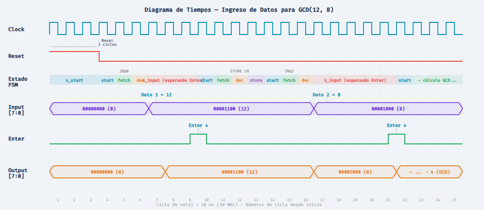

# Microprocesador EC-2 — Implementación Estructural en VHDL

Implementación completa del microprocesador de propósito general **EC-2** en VHDL, utilizando una arquitectura **estructural portable (FSM+D)** compatible con cualquier herramienta de síntesis o simulación: Intel Quartus, Xilinx Vivado/ISE, Lattice Diamond, GHDL, ModelSim, etc.

> Basado en el Capítulo 12 de *"Digital Logic and Microprocessor Design with VHDL"* — Enoch O. Hwang

---

## Arquitectura General

El EC-2 es un microprocesador de **8 bits** con las siguientes características:

| Característica       | Valor                                      |
|----------------------|--------------------------------------------|
| Ancho de datos       | 8 bits                                     |
| Ancho de instrucción | 8 bits (3-bit opcode + 5-bit dirección)    |
| Contador de programa | 5 bits (32 posiciones)                     |
| Memoria              | RAM 32×8 bits (programa + datos unificados)|
| Acumulador           | 8 bits (registro A)                        |
| Señales de control   | 8 (desde la CU hacia el Datapath)          |
| Señales de estado    | 2 (Aeq0, Apos — desde el Datapath hacia CU)|

### Diagrama de bloques

```
                    ┌─────────────────────────────────┐
                    │           mp.vhd                │
                    │         (Top-Level)              │
                    │                                  │
                    │  ┌──────────┐   ┌────────────┐  │
      clock ───────►│  │  cu.vhd  │   │   dp.vhd   │  │
      reset ───────►│  │  (FSM)   │──►│ (Datapath)  │  │
      enter ───────►│  │          │◄──│             │  │──► output[7:0]
      input[7:0] ──►│  │ 8 ctrl   │   │ Componentes:│  │
                    │  │ signals  │   │ • ram.vhd   │  │
                    │  │          │   │ • reg.vhd   │  │
                    │  └──────────┘   │ • mux2.vhd  │  │
                    │   IR(7:5)▲ │    │ • mux4.vhd  │  │
                    │   Aeq0   │ │    │ • increment  │  │
                    │   Apos   │ │    │ • addsub    │  │
                    │          └─┘    └────────────┘  │
                    └─────────────────────────────────┘
```

---

## Conjunto de Instrucciones

```
=====================================================
 Formato: [OPCODE(7:5)] [DIRECCIÓN(4:0)]  (8 bits)
=====================================================
 Opcode  Instrucción   Operación
 "000"   LOAD  addr    A ← M[addr]
 "001"   STORE addr    M[addr] ← A
 "010"   ADD   addr    A ← A + M[addr]
 "011"   SUB   addr    A ← A - M[addr]
 "100"   IN            A ← entrada usuario
 "101"   JZ    addr    Si A=0, PC ← addr
 "110"   JPOS  addr    Si A>0, PC ← addr
 "111"   HALT          Detener ejecución
=====================================================
```

Cada instrucción se ejecuta en **4 ciclos de reloj**: `start → fetch → decode → execute`.

---

## Estructura de Archivos

```
Microprocesador_EC-2/
├── mp.vhd            ← Top-level: conecta CU + Datapath
├── cu.vhd            ← Unidad de control (FSM behavioral)
├── dp.vhd            ← Datapath estructural (versión portable)
├── ram.vhd           ← RAM 32×8 con programa GCD hardcoded
├── reg.vhd           ← Registro genérico de N bits (behavioral)
├── increment.vhd     ← Incrementador de N bits (dataflow)
├── mux2.vhd          ← Multiplexor 2:1 genérico (dataflow)
├── mux4.vhd          ← Multiplexor 4:1 genérico (dataflow)
├── addsub.vhd        ← Sumador/Restador de N bits (dataflow)
└── README.md
```

---

## Descripción de Componentes

### `mp.vhd` — Top-Level Estructural

Entidad de nivel superior que instancia y conecta la **Unidad de Control** (`cu`) con la **Ruta de Datos** (`dp`). Define los puertos externos del microprocesador:

- **Entradas:** `clock`, `reset`, `enter`, `input[7:0]`
- **Salidas:** `output[7:0]`

Las señales de control (IRload, JMPmux, PCload, Meminst, MemWr, Asel, Aload, Sub) viajan de la CU al Datapath. Las señales de estado (IR, Aeq0, Apos) viajan del Datapath a la CU.

### `cu.vhd` — Unidad de Control (FSM)

Máquina de estados finitos (FSM) con **11 estados** que controla la secuencia de ejecución:

| Estado      | Función                                                   |
|-------------|-----------------------------------------------------------|
| `s_start`   | Estado inicial — espera para comenzar                     |
| `s_fetch`   | Carga la instrucción de memoria al IR                     |
| `s_decode`  | Decodifica el opcode y dirige al estado de ejecución      |
| `s_load`    | Ejecuta LOAD: A ← M[addr]                                |
| `s_store`   | Ejecuta STORE: M[addr] ← A                               |
| `s_add`     | Ejecuta ADD: A ← A + M[addr]                             |
| `s_sub`     | Ejecuta SUB: A ← A - M[addr]                             |
| `s_input`   | Ejecuta IN: espera `enter='1'`, luego A ← Input          |
| `s_jz`      | Ejecuta JZ: si A=0, PC ← addr                            |
| `s_jpos`    | Ejecuta JPOS: si A>0, PC ← addr                          |
| `s_halt`    | Detiene el procesador (permanece en este estado)          |

Genera las **8 señales de control** mediante asignaciones concurrentes condicionales.

### `dp.vhd` — Datapath Estructural Portable

Ruta de datos que instancia 9 componentes hardware interconectados:

| Instancia | Componente      | Función                                              |
|-----------|-----------------|------------------------------------------------------|
| U0        | `reg` (8 bits)  | **IR** — Registro de instrucción                     |
| U1        | `mux2` (5 bits) | **JMPmux** — Selección PC+1 o dirección de salto     |
| U2        | `reg` (5 bits)  | **PC** — Contador de programa                        |
| U3        | `mux2` (5 bits) | **Meminst** — Selección dirección de memoria          |
| U4        | `increment`     | **Incrementador** — PC + 1                           |
| U5        | `ram`           | **RAM 32×8** — Memoria de programa/datos             |
| U6        | `mux4` (8 bits) | **Asel MUX** — Selección de entrada al acumulador    |
| U7        | `reg` (8 bits)  | **Acumulador A** — Registro principal                |
| U8        | `addsub`        | **ALU** — Sumador/Restador                           |

### `ram.vhd` — RAM 32×8 con Programa Hardcoded

Memoria RAM de 32 posiciones × 8 bits con:
- **Lectura combinacional** (asíncrona) — disponible en el mismo ciclo
- **Escritura síncrona** — en flanco ascendente del reloj cuando `we='1'`
- **Programa GCD** precargado en la constante `INIT` — calcula el Máximo Común Divisor por restas sucesivas

Para cambiar el programa, solo se modifica el arreglo `INIT` dentro de este archivo.

### `reg.vhd` — Registro Genérico (Behavioral)

Registro de N bits con reset asíncrono y carga habilitada. Usado como IR (8 bits), PC (5 bits) y Acumulador (8 bits). Se activa en flanco ascendente del reloj cuando `Load='1'`.

### `increment.vhd` — Incrementador (Dataflow)

Circuito combinacional que suma 1 a su entrada. Implementado con asignación concurrente usando `IEEE.numeric_std`. Se usa para calcular PC+1.

### `mux2.vhd` — Multiplexor 2:1 (Dataflow)

Multiplexor genérico de N bits con selección por 1 bit. Implementado con `WHEN-ELSE` concurrente:
- `S='0'` → Y = D0
- `S='1'` → Y = D1

### `mux4.vhd` — Multiplexor 4:1 (Dataflow)

Multiplexor genérico de N bits con selección por 2 bits. Implementado con `WITH-SELECT` concurrente. El orden de puertos es `D3, D2, D1, D0`:
- `"00"` → Y = D0 (RAM directa — LOAD)
- `"01"` → Y = D1 (resultado ALU — ADD/SUB)
- `"10"` → Y = D2 (entrada usuario — IN)
- `"11"` → Y = D3 (no usado)

### `addsub.vhd` — Sumador/Restador (Dataflow)

Unidad aritmética de N bits que realiza suma o resta según la señal `S`:
- `S='0'` → F = A + B (suma)
- `S='1'` → F = A - B (resta, complemento a dos)

Genera banderas de overflow con signo y sin signo (no usadas por el EC-2).

---

## Señales de Control

| Señal    | Función                                           |
|----------|---------------------------------------------------|
| IRload   | Cargar instrucción de memoria en IR               |
| JMPmux   | 0: PC+1 (secuencial), 1: IR(4:0) (salto)         |
| PCload   | Cargar nueva dirección en el PC                   |
| Meminst  | 0: dirección = PC (fetch), 1: dirección = IR(4:0) |
| MemWr    | Habilitar escritura en RAM                        |
| Asel[1:0]| Selección del MUX 4:1 para entrada del acumulador |
| Aload    | Cargar nuevo valor en el acumulador A             |
| Sub      | 0: suma (A+B), 1: resta (A-B)                    |

## Señales de Estado

| Señal | Función                            |
|-------|------------------------------------|
| Aeq0  | '1' cuando A = 0 (para JZ)        |
| Apos  | '1' cuando A > 0 (para JPOS)      |

---

## Programa Precargado: GCD (Máximo Común Divisor)

La RAM viene inicializada con un programa que calcula el GCD de dos números por restas sucesivas:

```
Dir  Binario     Instrucción     Descripción
---  --------    -----------     -----------
0    10000000    IN              A ← primer número
1    00111100    STORE 28        M[28] ← a
2    10000000    IN              A ← segundo número
3    00111101    STORE 29        M[29] ← b
4    00011100    LOAD 28         A ← a              [LOOP]
5    01111101    SUB 29          A ← a - b
6    10101110    JZ 14           si a==b → DONE
7    11001100    JPOS 12         si a>b  → A_GT_B
8    00011101    LOAD 29         A ← b              [B_GT_A]
9    01111100    SUB 28          A ← b - a
10   00111101    STORE 29        M[29] ← nuevo b
11   11000100    JPOS 4          → LOOP
12   00111100    STORE 28        M[28] ← a-b        [A_GT_B]
13   11000100    JPOS 4          → LOOP
14   00011100    LOAD 28         A ← GCD            [DONE]
15   11100000    HALT            Fin
```

---

## Guía de Simulación

El siguiente diagrama de tiempos muestra la secuencia de ingreso de datos para calcular el GCD(12, 8) con el programa precargado en la RAM:



### Pasos para simular:

1. **Reset** (3 ciclos): Mantener `reset='1'` durante al menos 3 ciclos de reloj para inicializar todos los registros.
2. **Primer dato (IN #1):** El procesador entra al estado `s_input` y espera. Colocar el primer número en `Input[7:0]` (ejemplo: `00001100` = 12) y pulsar `enter='1'` durante 1 ciclo.
3. **STORE 28:** El procesador ejecuta automáticamente `STORE 28` para guardar el primer número en M[28].
4. **Segundo dato (IN #2):** El procesador vuelve a `s_input`. Colocar el segundo número en `Input[7:0]` (ejemplo: `00001000` = 8) y pulsar `enter='1'`.
5. **Cálculo automático:** El procesador ejecuta el algoritmo GCD por restas sucesivas hasta alcanzar `HALT`.
6. **Resultado:** El valor de `Output[7:0]` muestra el GCD (en este caso, `00000100` = 4).

> **Nota:** Cada instrucción toma 4 ciclos de reloj (start → fetch → decode → execute). El estado `s_input` permanece esperando hasta que `enter='1'`.

---

## Compatibilidad

✅ **100% portable** — Solo usa librerías estándar IEEE (`std_logic_1164`, `numeric_std`).  
✅ **Sin dependencias propietarias** — No requiere `LIBRARY lpm` ni archivos `.mif`.  
✅ **Multi-plataforma** — Probado con Intel Quartus, GHDL y ModelSim.

---

## Referencia

Hwang, E. O. (2018). *Digital Logic and Microprocessor Design with VHDL* — Chapter 12: General-Purpose Microprocessors.

---

## Autor

**Luis Acosta** — PDI Advanced  
Curso de Diseño de Microprocesadores
